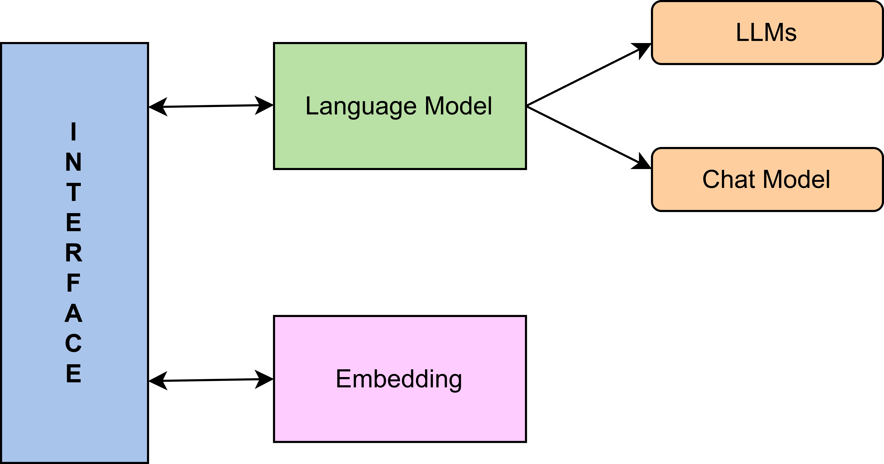
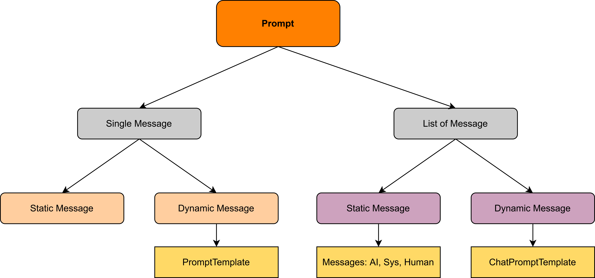
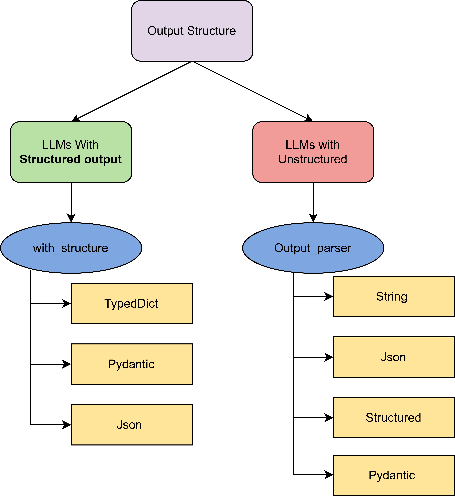

# LangChain

LangChain is an open-source framework for building applications powered by Large Language Models (LLMs).

---

## LangChain Components

### 1. Model
* **Why:** Since many LLMs are available and each provides a slightly different API structure for calling them, there is **no standard way of using APIs**.
* **Solution:** A common, standard interface.
* **Definition:** The core interface through which an application interacts with AI models (LLMs).
  * *Different APIs $\rightarrow$ Different Interfaces/Code*
  * *LangChain $\rightarrow$ Standard Interface and Code*

#### LangChain Providers: Direct vs. Cloud-Hosted

1. **Direct (Native) Providers**
   * **What it is:** You connect directly to the model creator's public API (e.g., OpenAI, Anthropic, Google AI Studio).
   * **Key Features:**
     * Simple API Key Auth
     * Public Shared Endpoints
     * Standard Model Names

2. **Cloud-Hosted (Managed) Providers**
   * **What it is:** You connect to models hosted inside your own enterprise cloud tenant (e.g., Azure OpenAI, AWS Bedrock, GCP Vertex AI).
   * **Key Features:**
     * Enterprise IAM & Identity Auth
     * Private Endpoints & VNet Isolation
     * Custom Resource Routing & Regions

3. **In a Nutshell**
   Cloud-hosted models require extra setup parameters because they replace:
   * **Simple Auth** $\rightarrow$ **Enterprise Authentication** (IAM roles, Entra ID, Service Accounts)
   * **Public Routing** $\rightarrow$ **Private Routing** (Specific Cloud Regions, Project IDs, Endpoint URLs, and Deployment Names)

#### Code Workflow
1. **Closed-Source LLMs:**
   1. Load API keys (`load_dotenv()`).
   2. Initialize the model (using a prebuilt class in LangChain).
   3. Call `invoke()`.
   4. Access `response.content`.
2. **Hugging Face Open-Source Models (Local or API):**
   1. Load API key (`load_dotenv()`).
   2. Set up the Hugging Face interface (`HuggingFaceEndpoint`).
   3. Initialize the model (`ChatHuggingFace`).
   4. Call `invoke()`.
   5. Access the response.

---

### 2. Prompt
* **PromptTemplate:**
  * A `PromptTemplate` in LangChain is a structured way to create prompts dynamically by inserting variables into predefined templates instead of hardcoding prompts.
  * It allows you to define placeholders that are filled at *runtime* with different inputs.
  * **Why use it:**
    * Default validation
    * **Reusable:** Create a separate Python file for `PromptTemplate` and save it in JSON.
    * **LangChain Ecosystem:** Can be seamlessly integrated into **chains**.
* **Message Types:** `SystemMessage`, `AIMessage`, `HumanMessage`

#### Code Workflow
1. Create a template using `PromptTemplate()`.
2. Fill the placeholders using `template.invoke()`. *(These two steps set the template with placeholders and generate the formatted prompt).*
3. Pass the formatted prompt to `model.invoke(prompt)`.

#### Summary: Why We Need Them
1. **`PromptTemplate`:** Makes prompts dynamic while adding reusability, validation, and alignment with the LangChain ecosystem.
2. **`ChatPromptTemplate`:** Maintains chat history while explicitly specifying which role sent each message.

---

### 3. Output Structure
* Used for system-to-system communication, which is essential in AI agent workflows.
* **`with_structured_output()`:** Specifies the expected output data format. Supported formats include:
  * **`TypedDict`:** Suggests/hints at the expected data types.
  * **`Pydantic`:** Enforces strict type validation.
  * **`json_schema`:** Defines structure using standard JSON Schema.

#### Pydantic Features
1. **Standard Pydantic:** Inherit from `BaseModel`.
2. **Optional Fields:** Use `Optional` with default initialized values.
3. **Type Coercion:** Automatically interprets input types and converts them when possible (e.g., `"123"` $\rightarrow$ `123`).
4. **Validation & Constraints:** Supports `Field` functions and specialized validators (e.g., `EmailStr`).

#### Code Workflow
* Call `model.with_structured_output(DataFormat)` where `DataFormat` is a `TypedDict`, `Pydantic` model, or `JSON` schema.

---

### 4. Output Parsers
Output parsers help convert **raw LLM responses** into **structured formats** like strings, JSON, CSV, or Pydantic models.
1. **`StrOutputParser`:** Converts LLM output $\rightarrow$ plain `String`.

---

### 5. Chains
* Applications are made up of multiple small steps.
* Executing each step individually is lengthy and time-consuming.
* **Chains** allow you to connect these steps into automated pipelines.

#### Code Workflow & Types
1. Create chains using **LCEL (LangChain Expression Language)**.
2. Pass input **only** to the first component of the chain.
3. Receive the final output from the last component of the chain.
4. **Types of Chains:**
   1. **Sequential Chain:** A simple linear pipeline.
   2. **Parallel Chain:** Uses `RunnableParallel` to run steps simultaneously.
   3. **Conditional Chain:** Uses `RunnableBranch` and `RunnableLambda` for branching logic.

---

### 6. Runnables

#### Why Runnables?
Different LangChain components historically used different method names:
1. Prompts $\rightarrow$ `format()`
2. LLMs $\rightarrow$ `predict()`
3. Parsers $\rightarrow$ `parse()`
4. Retrievers $\rightarrow$ `get_relevant_documents()`

**Solution:** A standardized execution interface across all components.

#### Core Concepts
* **Unit of Work:** Each runnable has a specific purpose (`Input -> Process -> Output`).
* **Common Interface:** Every runnable implements `invoke()`, `batch()`, and `stream()`.
* **Composability:** Because all runnables share the same interface, they can be chained together—and the combined pipeline itself becomes a new runnable.

#### Types of Runnables
1. **Task-Specific Runnables:** Core components (Prompts, LLMs, Parsers, Retrievers).
2. **Runnable Primitives:** Used to connect and orchestrate task-specific runnables:
   1. **`RunnableSequence`:** Executes runnables sequentially in a chain.
   2. **`RunnableParallel`:** Executes multiple runnables in parallel using a single input and returning a dictionary of outputs.
   3. **`RunnablePassthrough`:** Passes the input through unchanged as output *(useful for preserving intermediate results/responses)*.
   4. **`RunnableLambda`:** Converts any standard Python function into a runnable so it can be used inside a pipeline.
   5. **`RunnableBranch`:** A control-flow component for conditional routing (similar to `if / elif / else`). **Pass `(condition, runnable)` tuples inside `RunnableBranch`.**
   6. **LCEL (LangChain Expression Language):** Uses the `|` (pipe) operator to compose runnables cleanly (e.g., `prompt | model | parser`).